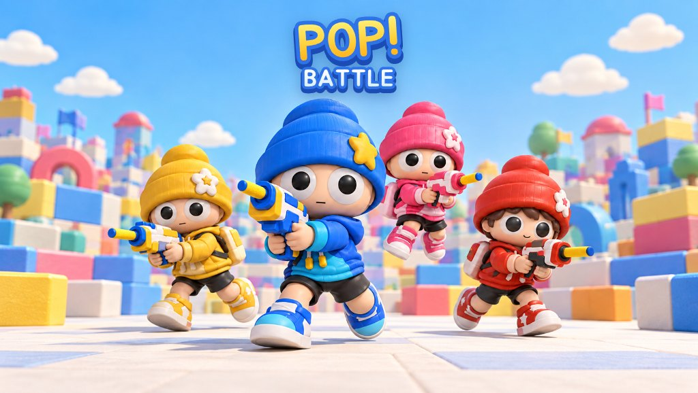
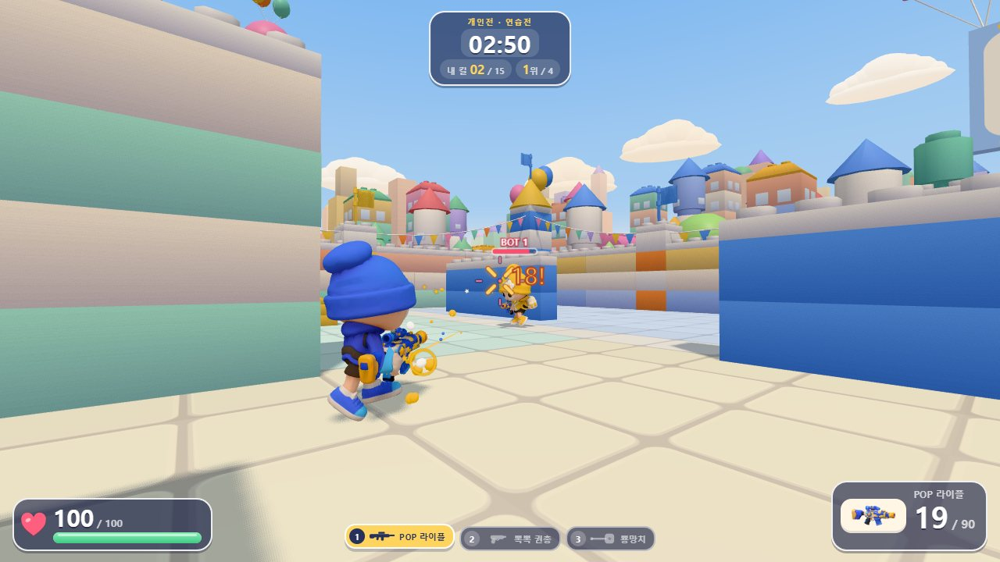
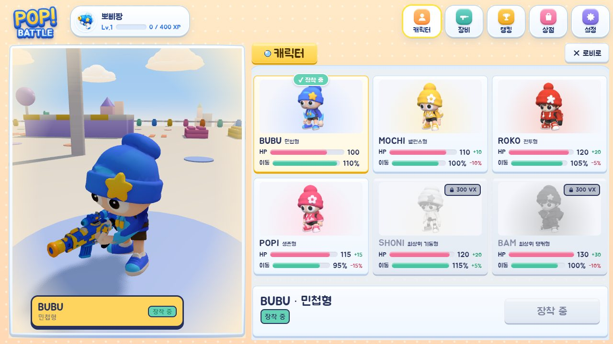
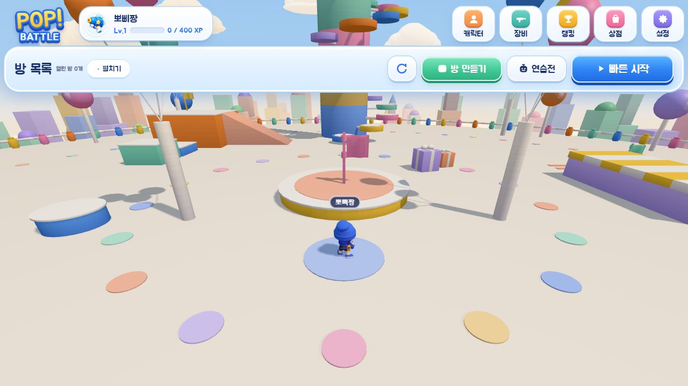
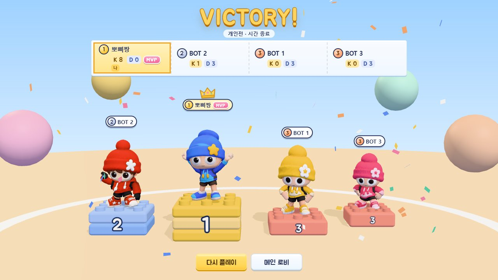
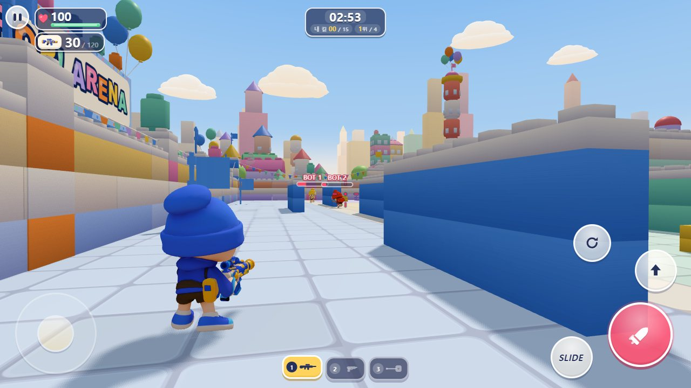
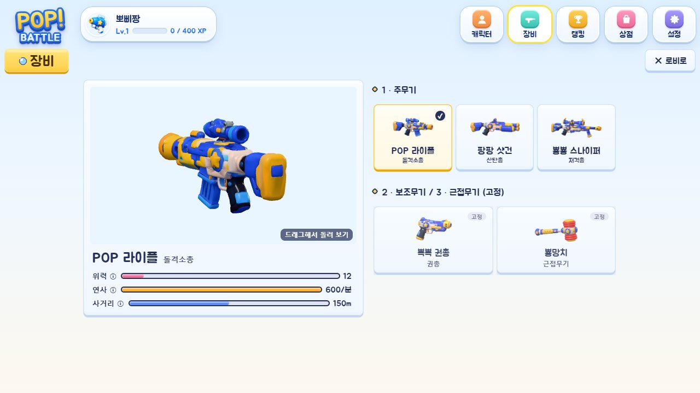

# POP! BATTLE

> 말랑한 장난감 총으로 펑! 귀여운 장난감 캐릭터들의 3인칭 슈팅.

2~2.5등신 장난감 캐릭터들이 파스텔 장난감 마을에서 폼 블래스터로 싸우는 3인칭 슈팅(TPS) 게임입니다.
Verse8(Agent8) 플랫폼에 배포했고, 설치 없이 PC·모바일 브라우저에서 바로 돌아갑니다.
PC는 키보드·마우스, 모바일은 가로 화면 가상 조이스틱·터치 버튼으로 조작합니다.

**▶ 플레이: https://verse8.io/u6j7e7C**

<p>
  
</p>

<p>
  
  
</p>

## 어떤 게임인가

- **전투:** 3인칭 시점으로 달리고, 점프하고, 슬라이딩하며 장난감 총을 쏩니다. 맞히면 "POP!" 하고 터지고
  피해 숫자가 튀어 오릅니다. 머리를 맞히면 헤드샷.
- **캐릭터 6종:** BUBU·MOCHI·ROKO·POPI(무료), SHONI·BAM(VX Shop 유료). 체력·이동 속도·키가 서로 다릅니다
  (능력치는 전투 성장과 무관한 캐릭터 고유값).
- **무기 5종:** 주무기 3종(POP 라이플·팡팡 샷건·뿅뿅 스나이퍼) 중 하나를 고르고, 뽁뽁 권총과 뿅망치는 기본 장착.
  숫자키·휠로 바로 바꿉니다.
- **모드:** 온라인 팀 데스매치(최대 4대4)·개인전(최대 8인), 봇 3명과 연습전. 온라인 매치는 2명부터 시작하고,
  팀전은 시작할 때 서버가 팀 인원 차이를 1명 이하로 맞춥니다.
- **로비:** 경기장 위 "하늘 놀이섬"을 다른 플레이어와 함께 자유롭게 뛰어다니다가 매치에 들어갑니다.
- **성장:** 경기 결과로 경험치를 얻어 Lv.1~100까지 오르고, 레벨마다 팝건 계급 아이콘이 바뀝니다.
  레벨 기준 통합 랭킹(상위 100명 + 내 순위).

<p>
  
  
</p>

## 주요 기능

**전투**
- 카메라 조준 레이 → 총구에서 실제 탄 경로로 다시 판정 (벽 모서리에 숨은 상대를 카메라만 보고 맞히지 않게).
  사격 경로 디버그 표시(조준 레이·총구·탄 경로·충돌 물체)로 확인.
- 무기마다 반동·탄 퍼짐·ADS 배율·사거리·재장전이 다르고, 스나이퍼는 조준경 화면.
- 피해 숫자·명중 표시·킬로그(확정 사망만, 실제 무기 모델 실루엣 아이콘)·인게임 상황판(PC Tab / 모바일 점수판 터치).
- 사망 표정, 리스폰 보호, 낙사.

**봇**
- 이동 격자를 Rapier 형상 검사로 구워 길찾기, 시야·청각(총소리) 감지, 엄폐물 찾기, 난이도별 반응 속도.

**모바일**
- 왼쪽 떠다니는 조이스틱(앞으로 계속 밀면 달리기), 오른쪽 드래그 시점, 사격·조준·점프·슬라이딩·재장전 버튼,
  버튼 크기·투명도 설정. 터치 회전분에만 약한 조준 보조.
- 세로로 든 기기에서도 게임 화면을 90° 돌려 가로로 플레이.
- 갤럭시 안드로이드 WebView에서 멀티터치 좌표가 밀리는 문제를 기록으로 찾아 보정.

**운영 요소**
- 닉네임(서버 계정별 저장, 금칙어·우회 표기·사칭 필터, 중복 방지), 첫 입장 때 닉네임·캐릭터 선택.
- VX Shop 유료 캐릭터 2종(서버 지급, 같은 구매 ID 중복 지급 방지).
- 한국어/English, 그래픽 품질(낮음·보통·높음), 사운드(전체·효과음·배경음·음소거).
- 첫 로딩 화면: 실제 진행률(게임 코드·GLB 받은 바이트·셰이더 준비), 느린 연결·실패 안내와 다시 시도.

<p>
  
  
</p>

## 기술 스택

| 영역 | 사용 기술 |
|---|---|
| 클라이언트 | TypeScript(strict), Vite 8, DOM UI(로비·HUD) |
| 3D·물리 | three.js 0.186, Rapier 3D(키네마틱 캐릭터 이동·레이캐스트·히트박스) |
| 서버 | Verse8 Agent8 Game Server (`server/src/server.ts`: 원격 함수 · 방 상태 · `$global` 사용자 상태/컬렉션 · `$lock`) |
| 플랫폼 | `@agent8/gameserver`, `@verse8/platform`(VX Shop) |
| 테스트 | Agent8 서버 하네스(`npm run server:test`: 매치·팀 배정·경험치·랭킹·결제·닉네임 필터) |
| 아트 | 캐릭터·무기: Codex 2D 레퍼런스 → Verse8 2D to 3D → GLB(Blender로 최적화), 맵: Kenney 키트 |

## 구조에서 신경 쓴 것

**결과는 서버가 정함**
멀티 매치의 상태·점수·승패, 경험치·레벨, 랭킹, 유료 캐릭터 보유는 서버가 확정하고 클라이언트는 읽기만 합니다.
경험치와 전적은 같은 계정 락·경기 ID로 한 번만 지급하고, 랭킹은 서버가 정렬해 상위 100명과 내 순위만 돌려줍니다.
로비 룸(`lb-`)과 매치 룸(`pb-`)을 나눠, 로비에서는 매치 함수가 전부 거절됩니다.

**연출과 판정을 분리**
`WeaponSystem`은 판정 결과만 내보내고, 총구 화염·탄·피해 숫자·효과음·HUD는 결과를 보고 따로 그립니다.
같은 규칙(무기·체력)을 서버와 공유 파일(`src/net/shared/protocol.ts`)로 맞춥니다.

**모바일까지 고려한 렌더링**
- 맵은 같은 모델을 InstancedMesh 하나로 묶고, 브릭은 텍스처 한 장을 공유. 무기 GLB는 7,000 삼각형·텍스처
  1024²로 줄인 사본을 기본으로 씁니다.
- 그래픽 품질 설정으로 그림자 맵 크기·배경 재질·해상도 배율을 바꾸고, HUD는 바뀐 글자만 다시 씁니다.
- 첫 로딩 마지막에 셰이더를 미리 컴파일하고 로딩 화면 뒤에서 실제 프레임을 그린 뒤 걷어, 첫 화면이 멈칫하지 않게.

**소리는 파일 없이 코드로**
효과음 35종과 배경음(로비·전투·승리·패배)을 WebAudio로 합성합니다(`src/audio/`). 배경음은 첫 입력 뒤 한 번 구워
반복하고, 발소리는 애니메이션에서 발이 닿는 순간에 맞춥니다.

**에셋은 장면에서 검증**
새 GLB는 `tools/inspect-glb.mjs`로 본·크기를 검사한 뒤 실제 장면(디버그 패널, 장착·애니메이션·게임 카메라)에서
확인합니다. 캐릭터 체형·비율 조정과 클립 리타깃은 Blender Python(`tools/blender/`)으로 하고, 결과를 렌더로 비교합니다.

## 실행

```bash
npm install
npm run dev            # http://localhost:5210
npm run build          # 타입 검사 + 배포 빌드
npm run server:test    # Agent8 서버 하네스
```

개발 서버 전용 확인 주소:
- `?char=<id>` 캐릭터 지정, `?botchars=yellow,red,pink` 봇 캐릭터, `?unlockall` 유료 캐릭터 잠금 해제
- `?net=1` 멀티 메뉴 바로 열기, `?teams=tdm` 팀 색 미리보기
- `?map=tower` / `?map=maze` / `?map=range` 시험 중인 맵 (배포·멀티는 POP! ARENA만)
- `` ` `` 디버그 패널, 콘솔 `__game.god()`(무적), `__game.setShotDebug(true)`(사격 경로)

## 조작 (PC)

| 키 | 동작 |
|---|---|
| WASD / Space | 이동 / 점프 |
| W 두 번 | 달리기 |
| Shift | 슬라이딩 |
| 좌클릭 / 우클릭 / R | 사격 / 조준(ADS) / 재장전 |
| 1 / 2 / 3, 휠 | 주무기 / 권총 / 뿅망치 |
| Tab | 로비: 메뉴, 매치: 상황판 |
| Esc | 일시정지 메뉴 |

## 폴더

```
src/
  core/         Game.ts(조립·메인 루프), 입력(키보드·마우스·터치), 첫 로딩 진행률
  combat/       무기 판정·조준 보조·체력·히트박스
  player/       캐릭터 이동(Rapier 키네마틱)·아바타(애니메이션·IK·무기 장착)·팀 색 외형
  bots/ ai/     봇, 행동 결정, 이동 격자
  world/        로비 하늘 놀이섬, 맵(maps/: 배치 데이터·빌더·바깥 도시)
  net/          Agent8 연결, 로비·매치 세션, 공용 규칙(shared/), 닉네임·상점
  ui/           HUD, 로비(lobby/), 결과 화면, 로딩 화면, 킬로그·상황판
  audio/        효과음·배경음 합성
  config/       무기·캐릭터·맵·그래픽·사운드 설정
  i18n/         한국어 → English 사전
server/src/     게임 서버 (매치·팀·경험치·랭킹·닉네임·결제)
tools/          GLB 검사, Blender 자동화(캐릭터 체형·리타깃·팀 마스크·최적화), 이미지 도구
docs/           멀티플레이 테스트, 에셋 점검, UI 수동 테스트, 개발 일지
public/assets/  게임용 GLB(캐릭터·무기·맵 키트), UI 이미지
```

## 에셋 출처

- 캐릭터·무기 3D 모델: Codex로 만든 2D 레퍼런스를 Verse8 2D to 3D로 변환(원본 보관 `art-src/`, 저장소에는 없음).
- 맵: [Kenney](https://kenney.nl) Brick Kit · Prototype Kit (CC0) — `public/assets/kits/`.
- 로딩 화면 일러스트: Codex 이미지 생성.
- 폰트: Jua (SIL OFL 1.1).
- 소리: 전부 코드 합성(외부 음원 없음).
